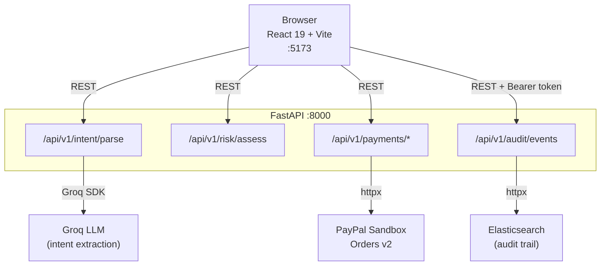

# AgentPay Guard

An AI-powered payment security platform that enforces controlled, auditable transactions through
natural-language intent parsing, deterministic risk assessment, human-in-the-loop reviewer
approvals, and a searchable Elasticsearch audit trail — all wired to the PayPal Sandbox Orders v2
API.

---

## Problem and Solution

Autonomous AI agents that initiate payments create a new class of risk: no human reviews the
intent, no policy engine checks the amount, and no audit trail records what happened.

AgentPay Guard addresses this by placing three gates in front of every payment:

1. **Intent parsing** — a Groq LLM extracts structured payment details from a natural-language
   request and verifies that every extracted value actually appears in the original text.
2. **Risk assessment** — a deterministic, rule-based engine scores the transaction and returns
   ALLOW, REVIEW, or BLOCK. No LLM is involved in the risk decision.
3. **Reviewer approval** — high-risk payments require an explicit human reviewer action before
   any PayPal call is made. Capture is always a separate, explicit reviewer step after buyer
   authorization.

---

## Architecture



The backend is a single FastAPI process. Payment records are held in memory — they are lost on
restart. Elasticsearch provides durable audit storage when configured; without it, events are
buffered in memory (max 1,000, not durable across restarts) and flushed when Elastic reconnects.

---

## Implemented Features

### Natural-Language Intent Parsing
- Groq LLM extracts merchant name, amount, currency, description, and purpose from free text.
- The model is instructed never to invent or default any field.
- Every extracted value is grounding-checked: it must appear verbatim in the original request.
- Values that fail grounding are dropped and reported in `missing_fields`.
- Model output is re-validated with the same Pydantic constraints as the payment schema; any
  extra field (e.g. a `decision` or `risk_score` injected by a prompt-injection attempt) makes
  the entire response invalid.

### Deterministic Risk Engine
- Pure rule-based scoring — no LLM, no external call.
- Supported currencies: USD, EUR, GBP, CAD, AUD, INR.
- USD and INR have explicit amount thresholds (elevated / review / block).
- EUR, GBP, CAD, AUD always return at least REVIEW (no thresholds defined).
- Any other currency always returns REVIEW.
- INR payments at or above ₹750,000 are always BLOCK regardless of any other rule.
- Amounts within 10% below the review threshold add a structuring penalty.
- The API rejects any client-supplied score, level, decision, or recommendation (422).

### PayPal Sandbox Orders v2 — Buyer Payment Flow
PayPal Orders v2 is a buyer-payment flow: the buyer (the person running the demo) approves the
payment on the PayPal Sandbox website. It is not an arbitrary payout to an external merchant.

The workflow has two distinct gates:

| Gate | Who | What happens |
|---|---|---|
| Reviewer approval | Human reviewer | `PENDING_REVIEW` → reviewer approves → PayPal order created |
| Buyer authorization | Buyer (demo user) | Buyer approves on PayPal Sandbox → backend authorizes |
| Capture | Human reviewer | Explicit reviewer action — never automatic |

Reviewer approval and buyer authorization are independent steps. A reviewer approving a payment
does not authorize it on PayPal; the buyer must still visit the PayPal approval URL. Capture
requires a separate, explicit reviewer action after authorization.

Each PayPal operation stores its `PayPal-Request-Id` before the call. Retrying after a timeout
cannot create a duplicate order, authorization, capture, or void.

INR payments are blocked before any PayPal call (PayPal Sandbox does not support INR).

### Human-in-the-Loop Reviewer Workflow
- Reviewer endpoints require `Authorization: Bearer <REVIEWER_TOKEN>` (32+ character shared
  secret, never in URLs or request bodies).
- If `REVIEWER_TOKEN` is missing or shorter than 32 characters the backend returns 503 and
  performs no action (fails closed).
- Reviewer reads (payment list, payment detail, audit events) also require the token.
- Unauthenticated client responses never contain risk scores, reviewer data, PayPal IDs, or
  authorization headers.

### Elasticsearch Audit Trail
Nine allowlisted event types are recorded: `RISK_ASSESSED`, `PAYMENT_CREATED`,
`PAYMENT_STATUS_CHANGED`, `REVIEW_APPROVED`, `REVIEW_REJECTED`, `PAYPAL_ORDER_CREATED`,
`PAYPAL_AUTHORIZATION`, `PAYPAL_CAPTURE`, `PAYPAL_VOID`, `PAYPAL_OPERATION_FAILED`.

Never indexed: intent request text, payment description/purpose, reviewer comments, PayPal
credentials, access tokens, reviewer token, idempotency keys, approval URLs, or raw PayPal
responses.

The index uses `"dynamic": "strict"` — Elasticsearch rejects any field not in the mapping.
Events are written with `PUT /_create/<event_id>` so a retry after a lost response cannot
create a duplicate.

Audit events never block payments. They are queued in memory and indexed by a background task.

---

## Technology Stack

| Layer | Technology |
|---|---|
| Backend framework | FastAPI 0.162, Uvicorn 0.54 |
| Data validation | Pydantic v2 |
| LLM (intent parsing) | Groq SDK (`groq==1.7.0`) |
| Payment API | PayPal Sandbox Orders v2 (via `httpx`) |
| Audit storage | Elasticsearch REST API (via `httpx`, no extra package) |
| Frontend | React 19, TypeScript 7, Vite 8 |
| Data grid | AG Grid Community 36 |
| Frontend tests | Vitest 5, Testing Library |
| Backend tests | pytest, FastAPI TestClient |

---

## Prerequisites

- Python 3.11+
- Node.js 20+
- [PayPal Developer](https://developer.paypal.com) sandbox app (Client ID + Secret)
- [Groq](https://console.groq.com) API key
- Elasticsearch Cloud deployment *(optional — the app runs in degraded mode without it)*

---

## Backend Setup

```bash
cd backend

# Create and activate a virtual environment
python -m venv .venv

# Windows (PowerShell / cmd)
.venv\Scripts\activate

# macOS / Linux
source .venv/bin/activate

# Install dependencies (includes pytest and httpx for tests)
pip install -r requirements-dev.txt

# Configure environment
cp .env.example .env
# Edit backend/.env — see Environment Variables below
```

Generate a `REVIEWER_TOKEN`:

```bash
python -c "import secrets; print(secrets.token_urlsafe(32))"
```

Start the API:

```bash
uvicorn app.main:app --reload --port 8000
```

- Health check: http://localhost:8000/health
- Interactive API docs: http://localhost:8000/docs

---

## Frontend Setup

```bash
cd frontend
cp .env.example .env        # sets VITE_API_BASE_URL=http://localhost:8000
npm install
npm run dev                 # http://localhost:5173
```

---

## Environment Variables

### `backend/.env`

Copy `backend/.env.example` to `backend/.env`. Never commit `backend/.env`.

| Variable | Required | Default | Purpose |
|---|---|---|---|
| `PAYPAL_CLIENT_ID` | for payments | — | PayPal Sandbox REST app |
| `PAYPAL_CLIENT_SECRET` | for payments | — | PayPal Sandbox REST app |
| `PAYPAL_BASE_URL` | no | Sandbox URL | Override only for testing |
| `PAYPAL_TIMEOUT_SECONDS` | no | `15` | Per-request timeout (1–60) |
| `REVIEWER_TOKEN` | for reviewer actions | — | Bearer token, 32+ characters |
| `GROQ_API_KEY` | for intent parsing | — | Groq API key |
| `GROQ_MODEL` | no | `openai/gpt-oss-120b` | Groq model ID |
| `ELASTIC_URL` | for durable audit | — | Elasticsearch HTTPS endpoint |
| `ELASTIC_API_KEY` | for durable audit | — | Elasticsearch API key |
| `ELASTIC_INDEX` | no | `agentpay-audit-events` | Audit index name |
| `ELASTIC_TIMEOUT_SECONDS` | no | `5` | Per-request timeout (1–30) |
| `FRONTEND_URL` | no | `http://localhost:5173` | CORS allowed origin |

Without `GROQ_API_KEY`, `/api/v1/intent/parse` returns `503 INTENT_SERVICE_UNAVAILABLE`; all
other endpoints work normally.

Without `ELASTIC_URL` / `ELASTIC_API_KEY`, audit events are held in an in-memory fallback buffer
(max 1,000 events, not durable across restarts). Payments are never affected by Elastic
availability.

### `frontend/.env`

| Variable | Default | Purpose |
|---|---|---|
| `VITE_API_BASE_URL` | `http://localhost:8000` | Backend base URL |

---

## Running Tests

### Backend

```bash
cd backend
pytest            # all tests
pytest -v         # verbose, one line per test
pytest tests/api  # API layer only
```

Backend tests use `FakeGroq` — no real Groq API calls are made and no API credits are consumed.
An autouse fixture fails any test that would reach the real SDK.

### Frontend

```bash
cd frontend
npm test          # single run
npm run test:watch  # watch mode
```

---

## PayPal Sandbox Demo Workflow

> This is a buyer-payment flow. The "buyer" is you, the demo user, approving a payment on the
> PayPal Sandbox website. No real money moves.

1. Open http://localhost:5173 in your browser.
2. On the **New Payment** page, enter a natural-language request, e.g.:
   `Pay 250 USD to Acme Cloud for software services.`
3. Parse the intent — the backend calls Groq and returns structured fields.
4. Submit for risk assessment — the backend scores the transaction.
   - ALLOW → payment is created and a PayPal order is opened immediately.
   - REVIEW → payment is created in `PENDING_REVIEW`; a reviewer must approve first.
   - BLOCK → payment is rejected; no PayPal call is made.
5. For REVIEW payments, open the **Approvals** page, enter your `REVIEWER_TOKEN`, and approve.
   The backend then creates the PayPal order.
6. Visit the `approval_url` returned in the response to approve the payment on PayPal Sandbox
   (log in with your PayPal Sandbox buyer account).
7. Return to the app and click **Authorize** — the backend reads the PayPal order status and
   creates the authorization.
8. On the **Approvals** page, click **Capture** to complete the payment.
9. Open the **Audit Logs** page (requires `REVIEWER_TOKEN`) to search the full event trail.

---


## Live Demo

**Frontend:** https://agentpay-guard-hackathon-1.onrender.com

**Backend Health:** https://agentpay-guard-hackathon.onrender.com/health

The frontend is hosted on Render and connects to the deployed FastAPI backend. PayPal integration uses the Sandbox environment. No real-money transactions are made.


## Known Limitations

| Limitation | Detail |
|---|---|
| In-memory payment records | All payment state is lost when the backend restarts. Run one worker only. |
| In-memory audit fallback | Without Elasticsearch, audit events are buffered in memory (max 1,000) and are not durable across restarts. |
| PayPal Sandbox only | Live PayPal URLs are rejected at startup by design. No real money is processed. |
| INR blocked at PayPal | INR payments pass risk assessment but are blocked before any PayPal call. PayPal Sandbox does not support INR. |
| No persistence layer | There is no database. Payment records exist only in the running process. |
| Single worker | In-memory state is not shared between workers. Do not run multiple Uvicorn workers. |

---

## Security Boundaries

- `backend/.env` is git-ignored and never committed.
- `REVIEWER_TOKEN` is accepted only in the `Authorization: Bearer` header — never as a query
  parameter or in a request body.
- Unauthenticated client responses (payment creation, order retry, authorize) never contain risk
  scores, reviewer names/comments, PayPal order/authorization/capture IDs, or error messages.
- Intent request text, payment descriptions, reviewer comments, and raw PayPal responses are
  never indexed in Elasticsearch.
- The risk engine rejects any client-supplied score, level, decision, or recommendation (422).
- Only `https://api-m.sandbox.paypal.com` is accepted as `PAYPAL_BASE_URL`; any Live PayPal URL
  stops the backend at startup.

---

## License

MIT — see [LICENSE](LICENSE).
